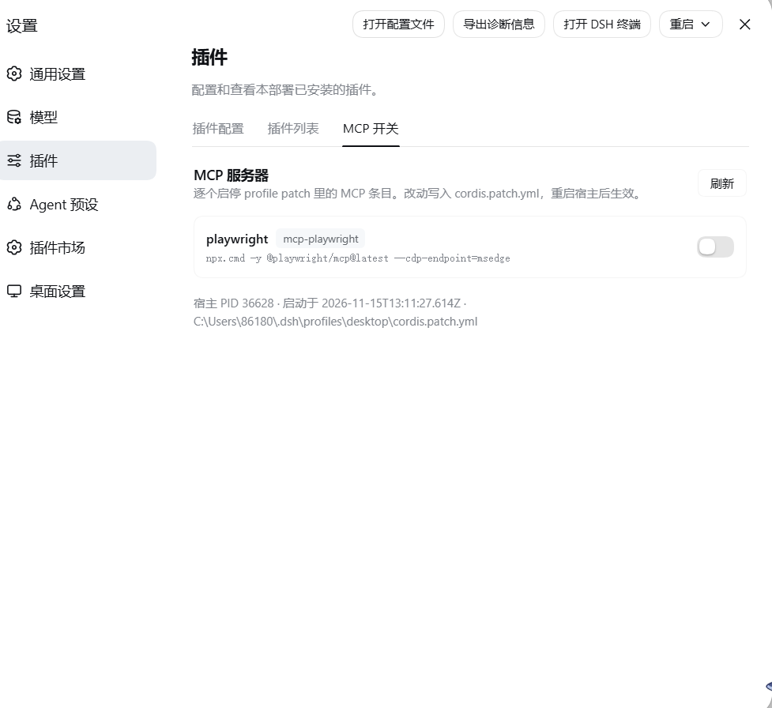
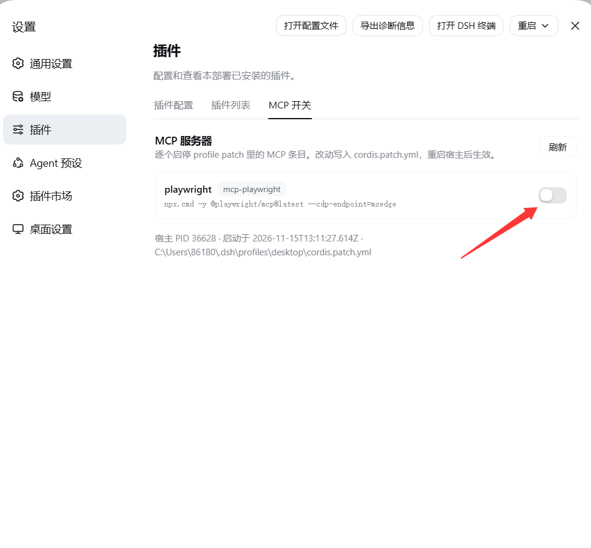
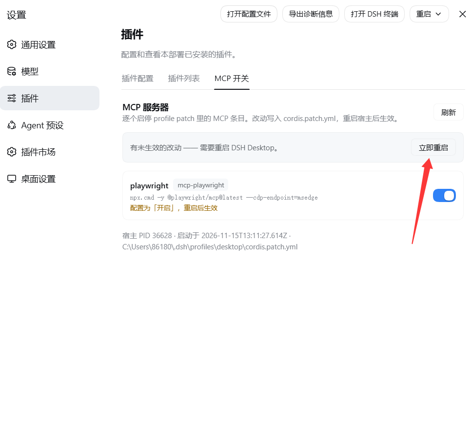

# dsh-mcp-panel

给 [DeepSeek Harness](https://github.com/deepseek-ai)（DSH）加一个 **MCP 开关面板**：在 **设置 → 插件 → 「MCP 开关」** 里列出当前 profile 配置的所有 MCP 服务器，每条一个开关，点一下就把对应条目写进 `cordis.patch.yml`，旁边的「立即重启」负责让改动生效。

> 一句话：DSH 没有管理 MCP 的界面，MCP 服务器只是 patch 文件里的一个 Loader 条目；这个插件把那些条目变成可以点的一排开关。

**基准环境：Windows 上的 DSH Desktop + Microsoft Edge。** 项目里的示例 MCP 服务器是 `@playwright/mcp`，用 `--cdp-endpoint=msedge` 接管你**已经打开的 Edge**（复用登录态、Cookie、扩展和现有标签页），所以必须先在 Edge 里打开远程调试开关 —— 见 [Edge 远程调试](#edge-远程调试给-mcp-用)。面板本身不绑定浏览器：它只是读写 patch 里的 MCP 条目，换成 Chrome 只要把示例里的 `msedge` 改成 `chrome`（详见[已知限制](#已知限制)）。

---

## 它长什么样



- **开关**：切换条目的 `disabled` 标志。文件里只动这一行，其余字节完全不动。
- **待生效标记**：插件在每次启动时把自己实际加载到的状态写进 `<profile>/.mcp-panel-applied.json`，再和当前配置对比。两者不一致时，该条目下方出现「配置为「关闭」，重启后生效」，并且顶部出现横幅 + **立即重启** 按钮。
- **立即重启**：弹一次确认，然后调用 DSH Desktop 自己的有序重启接口 `POST /api/desktop/restart`（设置页右上角那个「重启」用的是同一套机制：先回执渲染进程，再重启）。只有该接口不可用时，才回退到插件自己的 `/dsh-mcp-panel/restart`（Windows 下通过计划任务调度 —— 宿主直接 spawn 的子进程会被 job 对象连带收走，实测跑不到执行那一步）。

## 使用流程（三张图）

> 截图来自 DSH Desktop 2.0.11（Windows）。

**① 打开 设置 → 插件 → 「MCP 开关」**，每条 MCP 一行，右侧是当前状态。


**② 点右侧开关**，配置立刻改写（此时 MCP 进程还没变）。



**③ 顶部出现「有未生效的改动」，点「立即重启」**，重启后开关状态与进程才真正一致。



---

## Edge 远程调试（给 MCP 用）

本项目基于 **Microsoft Edge** 验证和运行。示例 MCP 服务器（`@playwright/mcp`）不是另开一个干净的浏览器，而是通过 `--cdp-endpoint=msedge` **接管你正在用的那一个 Edge 实例**，所以你在页面里的登录态、Cookie、已装扩展、已打开的标签页全都直接可用。

代价是：Edge 默认不对外暴露调试端口，必须手动开一次开关。

1. 在 Edge 地址栏打开 **`edge://inspect/#remote-debugging`**
2. 勾选 **Allow remote debugging for this browser instance**
   （允许对此浏览器实例进行远程调试）
3. 不用关这个标签页，也不用重启 DSH，直接回去用即可

这个开关是**实例级**的：Edge 完全退出再启动后需要**重新勾一次**。勾上之后，Edge 才会在 `127.0.0.1:9222` 上暴露 CDP 端点（端口号可能变，实际端口和浏览器 id 写在 `<Edge User Data>\DevToolsActivePort` 里）。

**没勾会怎样**，两种典型报错：

```
Could not connect to msedge.
Make sure msedge is running with remote debugging enabled.
Navigate to chrome://inspect/#remote-debugging and check
"Allow remote debugging for this browser instance".
```

```
WebSocket error: ws://127.0.0.1:9222/devtools/browser/<id> 403 Forbidden
Connection rejected
```

第一种是端口上根本没有可连的调试会话；第二种是端口在监听但握手被拒（多半是那个浏览器实例的开关已经被关掉、或者 `DevToolsActivePort` 里记的还是上一个实例的 id）。两者的处理方式一样：

**排错顺序**：① 回到 `edge://inspect/#remote-debugging` 确认开关还勾着 → ② 看 `DevToolsActivePort` 里的 id 是否和当前 Edge 进程对得上 → ③ 都不行就彻底退出 Edge（任务栏托盘也要退）再重开，然后重新勾一次。

> 用 Chrome 的话把地址换成 `chrome://inspect/#remote-debugging`，配置里的 `--cdp-endpoint=msedge` 换成 `chrome`。


---

## 为什么开关不是即时的

这是本插件最重要的设计前提，也是它不假装自己能做到的事：

**被验证过的行为**：在 DSH Desktop 2.0.11 上，改 `cordis.patch.yml` **不会**热加载 —— 写入 `disabled: true` 后等 15 秒，MCP 服务器进程照样在跑；往 patch 里**新增**一个条目也不会被激活。所以：

| 动作 | 即时生效？ |
|---|---|
| 在面板上点开关 | ❌ 只写文件，进程不变 |
| 重启 DSH Desktop | ✅ 新配置生效 |
| 在 DSH 里新装插件（新增 insert 条目） | ❌ 也必须重启 |

如果哪天上游支持了 patch 热重载，这个插件不需要改：`pendingRestart` 会自动变回 `false`，横幅也就不出现了。

---

## 安装

### 方式 A：手动复制（最稳，不需要 pnpm）

1. 找到你的 profile 目录：

   ```
   Windows: C:\Users\<你>\.dsh\profiles\desktop
   macOS/Linux: ~/.dsh/profiles/desktop
   ```

2. 把整个仓库目录复制成 `<profile>/node_modules/dsh-mcp-panel`：

   ```powershell
   # Windows PowerShell
   $profile = "$env:USERPROFILE\.dsh\profiles\desktop"
   New-Item -ItemType Directory -Force "$profile\node_modules" | Out-Null
   Copy-Item -Recurse -Force .\mcp_switch "$profile\node_modules\dsh-mcp-panel"
   ```

   ```bash
   # macOS / Linux
   cp -R ./mcp_switch ~/.dsh/profiles/desktop/node_modules/dsh-mcp-panel
   ```

3. 在 `<profile>/cordis.patch.yml` 的顶层数组里追加一条（注意是 **追加**，别覆盖文件里已有的内容）：

   ```yaml
   - insert:
       - id: mcp-panel
         name: dsh-mcp-panel
   ```

   完整示例见 [`examples/install.patch.yml`](examples/install.patch.yml)。

4. **重启 DSH Desktop**。打开 设置 → 插件，应该多出一个 **「MCP 开关」** 标签页。

### 方式 B：pnpm 安装本地包

```powershell
cd "$env:USERPROFILE\.dsh\profiles\desktop"
pnpm add file:D:\path\to\mcp_switch
```

然后同样做第 3、4 步。DSH Desktop 会重写 `package.json` 里的 `dsh.profile.bundles`，但不会动 `dependencies`，所以这种装法能留下来。

### 卸载

删掉 `cordis.patch.yml` 里那条 insert，再删 `<profile>/node_modules/dsh-mcp-panel`，重启即可。插件被移除时 DSH 不会崩 —— 只是少一个标签页。

---

## 使用

1. 设置 → 插件 → **「MCP 开关」**
2. 想关哪个就点哪个开关（变灰 = 配置为关闭）
3. 点横幅里的 **立即重启**（或自己退出重开 DSH Desktop）
4. 重启后面板里该条目的「待生效」标记消失，MCP 进程也不再被拉起

**注意**：关掉的 MCP 意味着模型那边相应的 `mcp__<serverName>__*` 工具会整个消失（不是禁用，是不下发）。想恢复就再点一次开关 + 重启。

---

## 它认哪些条目

只在 patch 文件里找 `name: '@deepseek-ai/dsh-mcp-client'` 的 Loader 条目 —— 也就是 DSH 官方 MCP 客户端插件的每台服务器配置。一个典型条目：

```yaml
- insert:
    - id: mcp-playwright
      name: '@deepseek-ai/dsh-mcp-client'
      config:
        serverName: playwright
        transport: stdio
        command: npx.cmd
        args: ['-y', '@playwright/mcp@latest', '--cdp-endpoint=msedge']
```

面板会显示 `serverName` 和拼好的命令行（stdio）或 `url`（streamable-http）。`disabled: true`、`disabled: !!js ...` 都算关闭（除非字面量是 `false`）。

上面这个 `--cdp-endpoint=msedge` 的例子要能用，前提是 Edge 那边勾了远程调试开关，见 [Edge 远程调试](#edge-远程调试给-mcp-用)。

---

## HTTP 接口

面板 UI 就是调这三个路由，想自己接东西（脚本、别的界面）也可以直接用。**注意**：DSH Desktop 的 web server 只接受 Electron 渲染进程携带的 `x-dsh-desktop-renderer` 能力头，`curl http://127.0.0.1:43120/` 连首页都会 403 —— 所以这些路由只能在 DSH 界面内部调用（`fetch` 同源即可）。

| 方法 | 路径 | 说明 |
|---|---|---|
| GET | `/dsh-mcp-panel/state` | 返回 `{ patchPath, exists, updatedAt, bootedAt, hostPid, pendingRestart, entries[] }` |
| POST | `/dsh-mcp-panel/toggle` | 体：`{ "id": "mcp-playwright", "enabled": false }`；返回 `{ changed, state }` |
| POST | `/dsh-mcp-panel/restart` | **回退路径**：Windows 下经 `schtasks` 调度一次重启，返回 `{ scheduled: true, via: 'schtasks', task }`；非 win32 返回 500。面板优先用 DSH Desktop 的 `POST /api/desktop/restart`，只有它不可用时才走这里。 |

`entries[]` 每一项：`{ id, serverName, transport, command, url, args, enabled, booted, pendingRestart }`。

---

## 已知限制

- **不热生效**：见上文，这是上游行为，插件用「待生效」标记把真相摆出来。
- **示例链路是 Edge**：本项目以 Windows + DSH Desktop + Microsoft Edge 为基准验证。示例条目里的 `--cdp-endpoint=msedge` 只对 Edge 生效；要接管 Chrome 就改成 `chrome`，要接任意 Chromium 就用 `--cdp-endpoint=http://127.0.0.1:<端口>` 或 `ws://…/devtools/browser/<id>`。无论哪种，那个浏览器都必须先打开 `…://inspect/#remote-debugging` 里的「Allow remote debugging」开关，且 Edge/Chrome 重启后要重新勾。
- **只读写一个文件**：当前 profile 的 `cordis.patch.yml`。写在其它 overlay（`--patch` 传进来的额外文件）里的 MCP 条目面板看不到。
- **重启回退路径只在 Windows 实现**：面板的「立即重启」优先走 DSH Desktop 自带的 `/api/desktop/restart`，那条是跨平台的；只有它不存在时才会用插件自己的 `/restart`，而后者依赖 `schtasks` 与 `DSH Desktop.exe` 的固定安装路径，仅 Windows 可用。macOS/Linux 上请用应用自带的重启入口。
- **依赖行文本解析**：为了不多带依赖、并且保证写入时不动别的字节，插件用行扫描解析 YAML，而不是真正的 YAML 解析器。它只认识 `- id:` 开头的条目块和 `id / name / disabled / serverName / transport / command / url / args` 这几个键。花式写法（锚点、多行标量、流式 map）不保证能认。
- **外部 HTTP 不可用**：受 DSH Desktop 的能力头限制，见上。

---

## 目录结构

```
mcp_switch/
├── lib/
│   ├── index.js      # 宿主侧：解析/改写 patch、三个 HTTP 路由、启动快照、重启调度
│   └── client.js     # 浏览器侧：window.__ModuleLoader__ 形态的 bundle，注册 settings.plugins.tab
├── examples/
│   └── install.patch.yml
├── package.json      # 含 dsh.client.platform = web 声明
├── README.md
└── LICENSE
```

两个半侧怎么协作：

- `package.json` 里的 `dsh.client.platform = "web"` + `exports["./client"]` 让宿主把 `lib/client.js` 当作浏览器 bundle 提供给 `/plugins`。
- `lib/client.js` 用 `window.__ModuleLoader__.load({ id, factory })` 注册一个 `apply(ctx)`，往 `settings.plugins.tab` 槽位塞一个 React 组件。
- 组件只做 `fetch`，所有文件读写都在宿主侧的 `lib/index.js` 里。

---

## License

MIT
